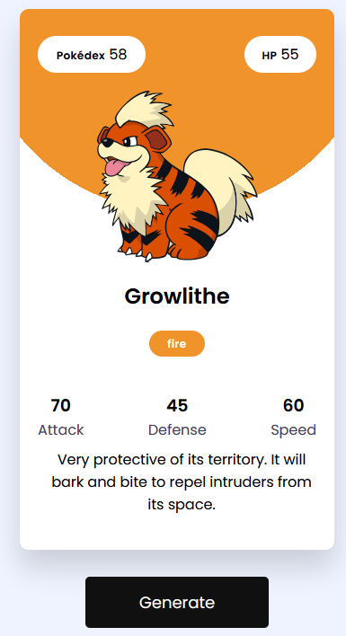

# Pokémon Card Generator

A single-page web app that generates a random Pokémon trading card from live [PokéAPI](https://pokeapi.co/) data. Each click of **Generate** fetches a new Pokémon and renders a card themed to its type.

Built with vanilla HTML, CSS, and JavaScript, with no frameworks or build step. The base project follows the [Coding Artist tutorial](https://codingartistweb.com/2021/09/pokemon-card-generator-javascript/). I extended it with a second API call to pull in Pokédex entry text.

## Features

- **Random generation:** picks one of the original 150 Pokémon on each click and on page load
- **Live API data:** displays name, Pokédex number, HP, Attack, Defense, Speed, types, and official artwork
- **Type-based theming:** card background and type badges are colored from the Pokémon's primary type
- **Pokédex entry:** a second request to the `pokemon-species` endpoint fetches the English flavor text and cleans up its line-break characters before display
- **Dynamic rendering:** the card is built from a template literal and injected into the DOM on every generation

## How It Works

1. A random ID (1-150) is generated.
2. `fetch` requests `/pokemon/{id}` for stats, types, and sprites, and the card is rendered right away.
3. A chained request to `/pokemon-species/{id}` retrieves the English flavor text, which is filled into the card once it arrives.
4. The primary type is mapped to a color palette to style the card via a CSS radial gradient.

## Tech Stack

| Area | Technology |
|------|------------|
| Markup | HTML5 |
| Styling | CSS3 (Flexbox, radial gradients), Google Fonts (Poppins) |
| Logic | JavaScript (ES6+): `fetch`, Promise chaining, template literals, DOM manipulation |
| Data | [PokéAPI](https://pokeapi.co/) (REST, no API key needed) |
